# Alero

[](https://github.com/k0op4/Alero/actions/workflows/ci.yml)
[](https://github.com/k0op4/Alero/actions/workflows/packages.yml)
[](LICENSE)

Connect Android and Windows directly over your local network or a USB cable. Transfer files, browse your phone, share the clipboard, mirror notifications and control either device from the other, without a cloud account.

**Alero 3.0.1 (3.0.1), the first stable release.** [Download Android, Windows and Linux](https://github.com/k0op4/Alero/releases) · [Changelog](CHANGELOG.md)

## Screenshots

Made-up data, regenerated with `flutter test --update-goldens test/shots/shots.dart`. [Versión en español](docs/screenshots/es/).

**Windows**

<p>
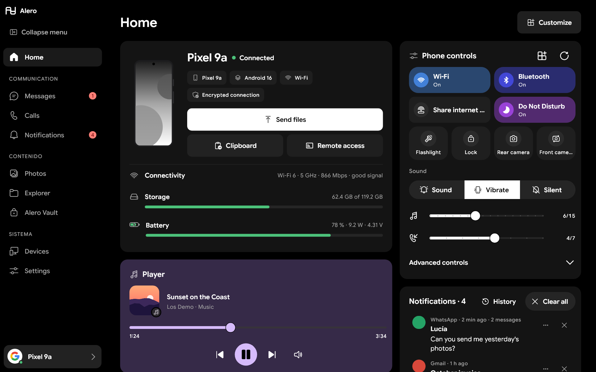
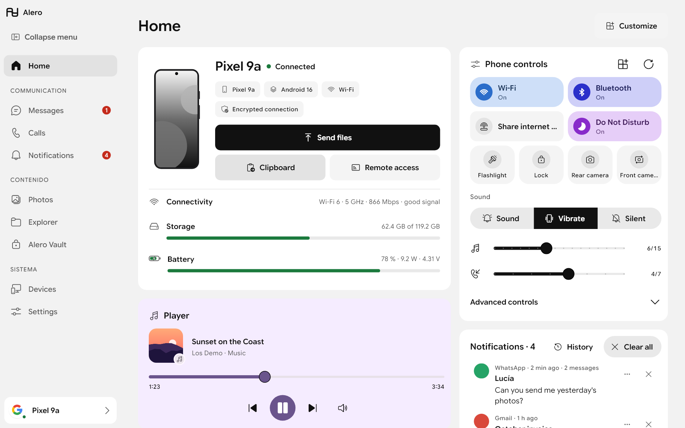
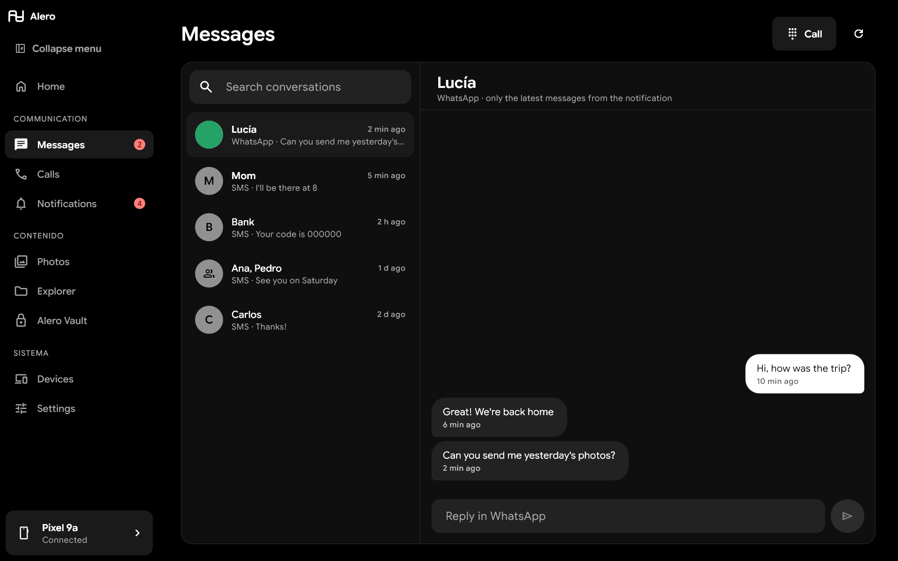
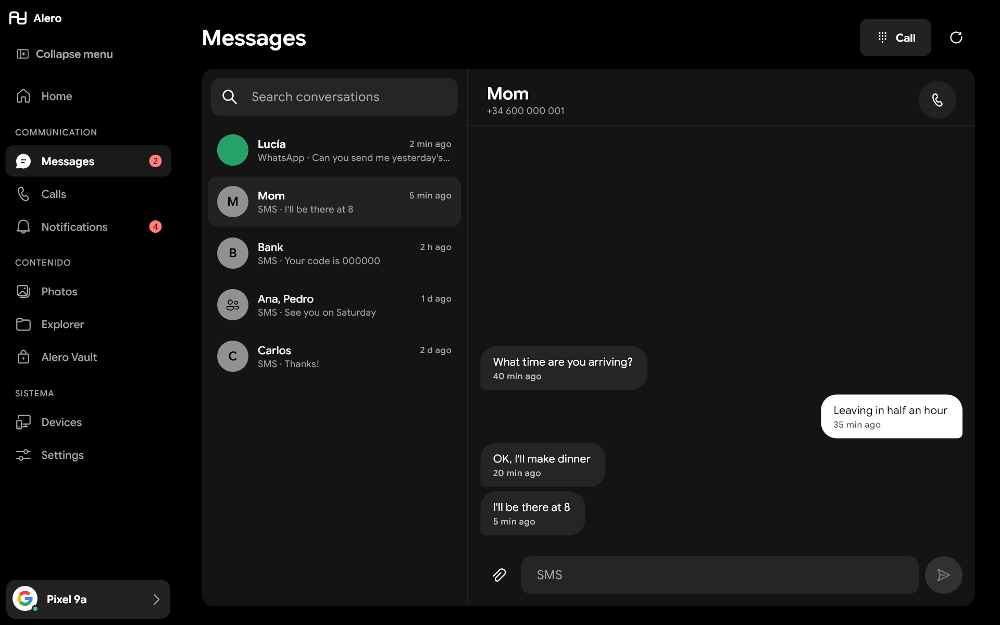
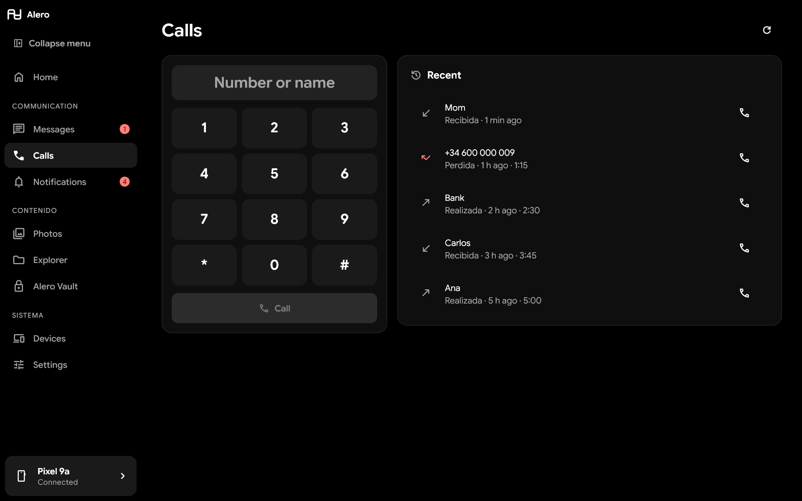
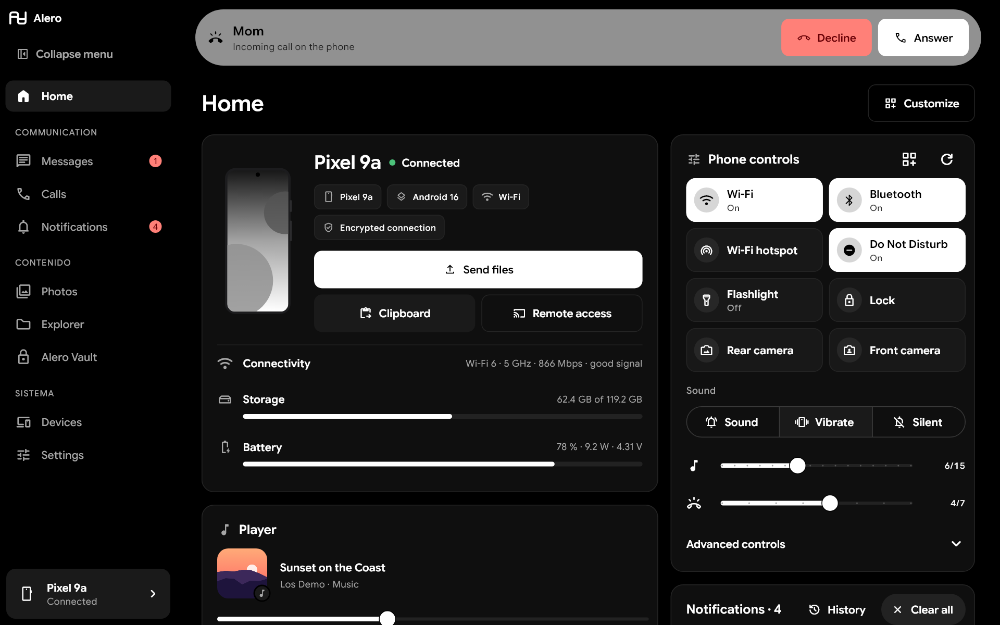
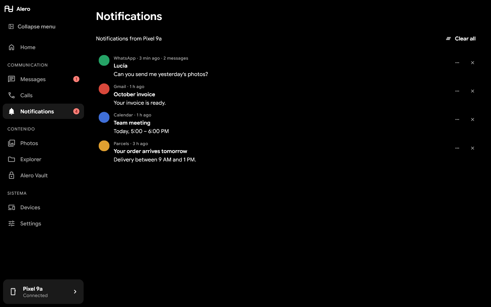
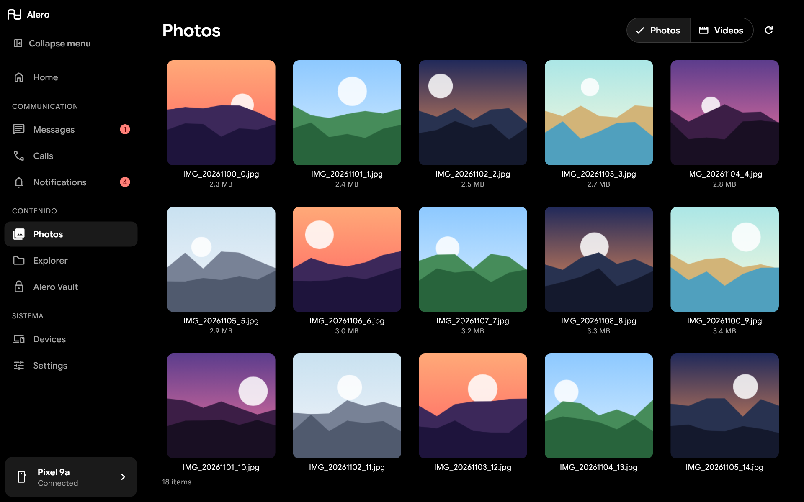
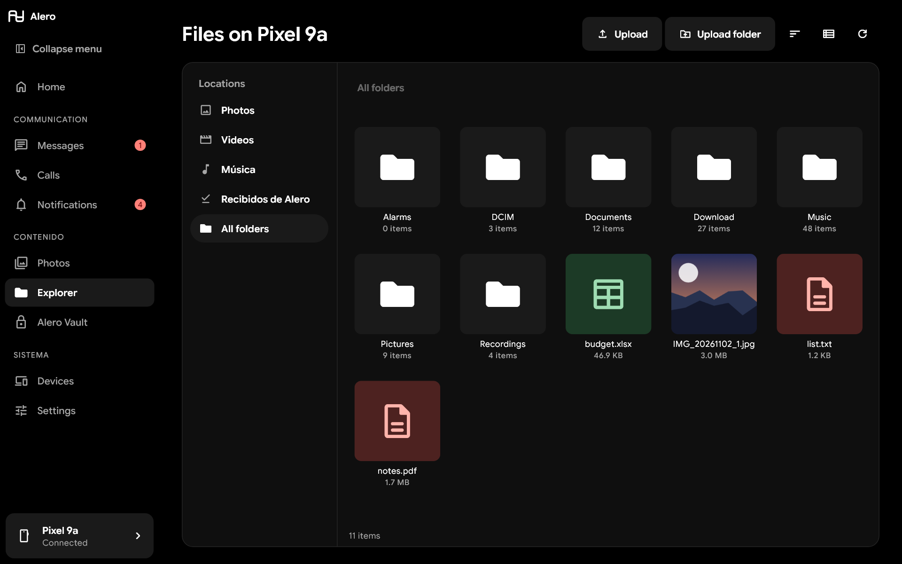
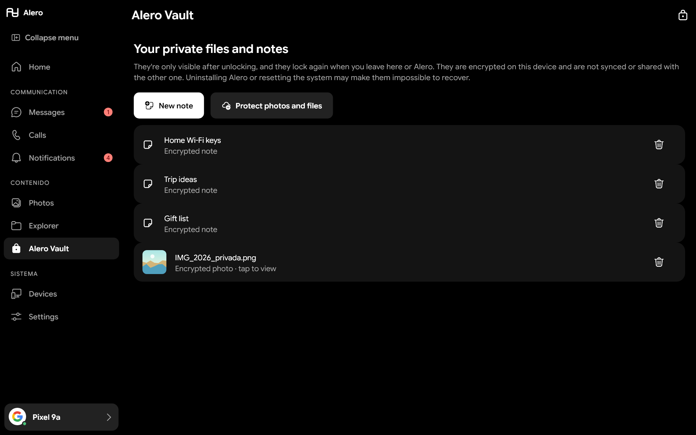
</p>

<details><summary>Devices and Settings (full page)</summary>

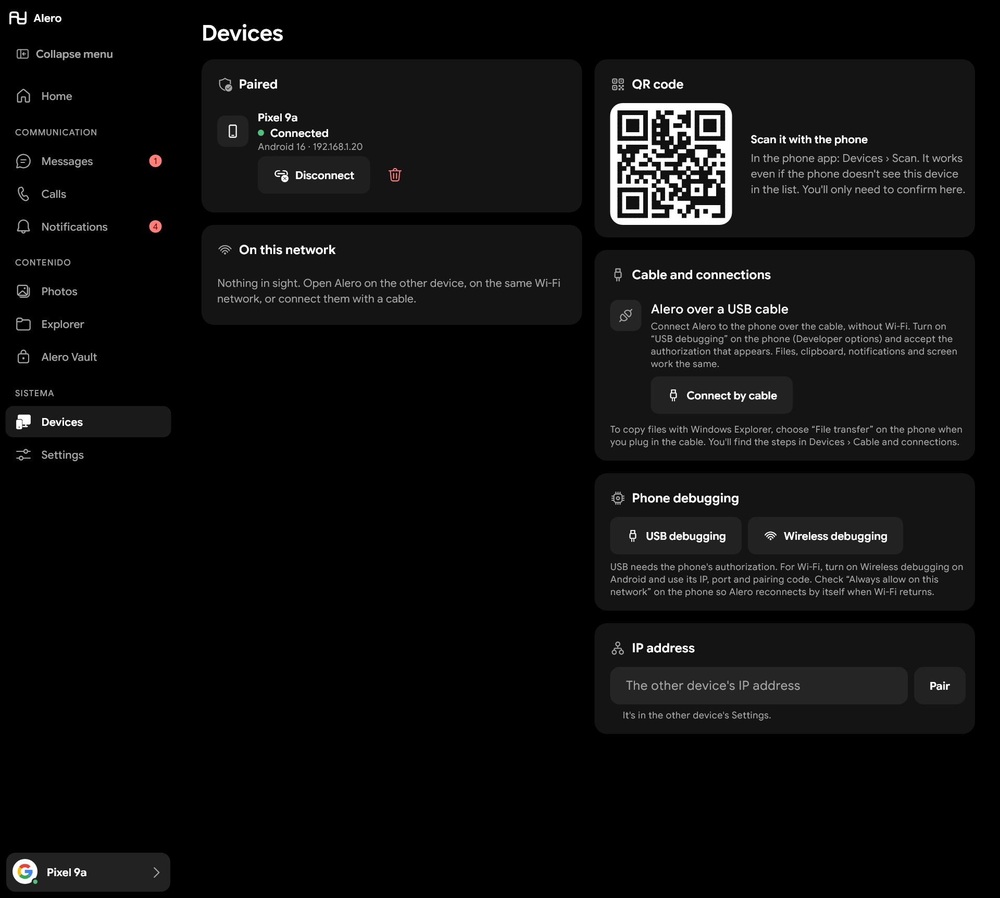
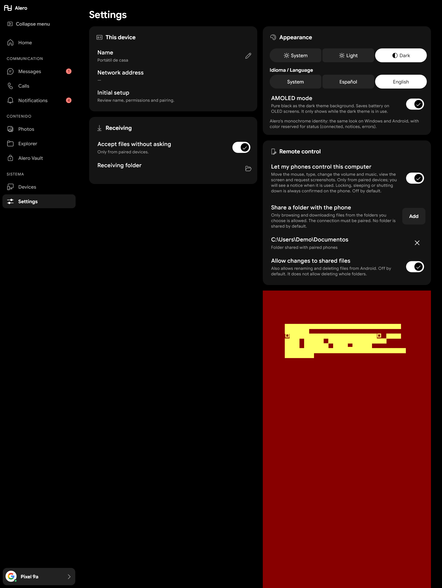

</details>

**Android**

<p>
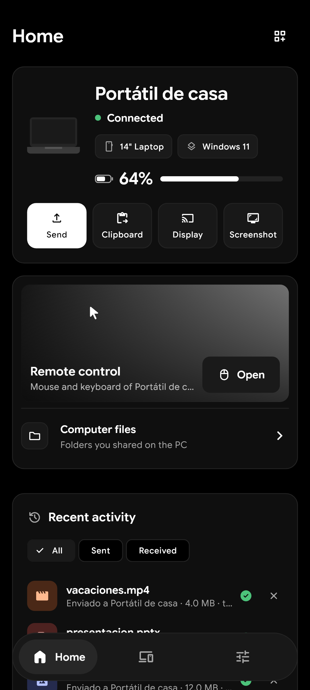
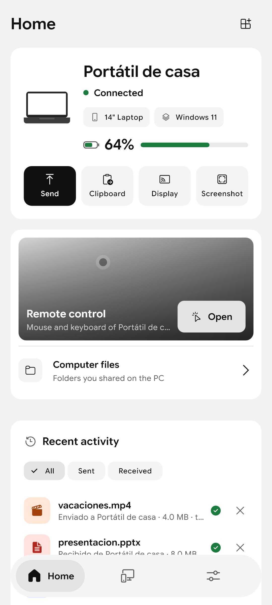
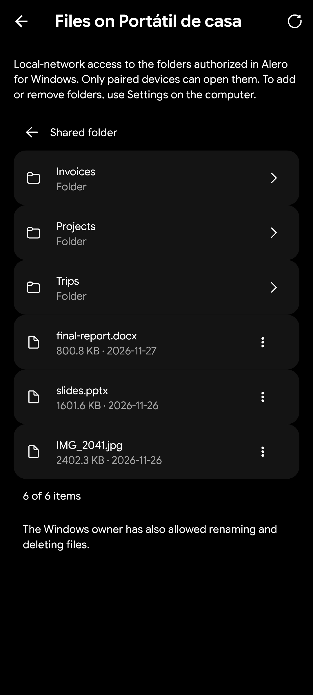
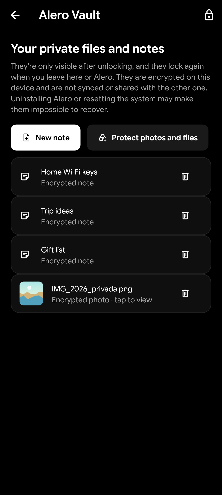
</p>

<details><summary>Devices and Settings (full page)</summary>

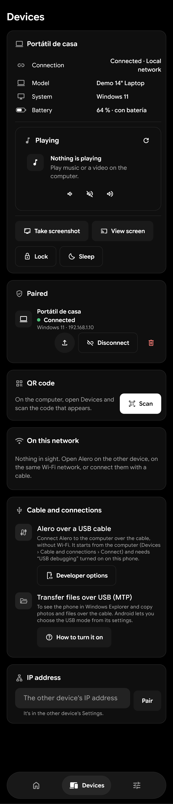
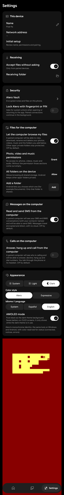

</details>

## Features

| From the computer | From the phone |
| --- | --- |
| Send files and folders, with resumable transfers | Send files and share from any app |
| Browse, rename and delete the phone's files | Browse the folders the computer shares |
| Notifications with replies, SMS and calls | Touchpad, keyboard and media keys for the computer |
| Phone screen, camera, webcam and screen recording (scrcpy) | The computer's screen, live, with its pointer |
| Quick controls: Do Not Disturb, torch, volume, find my phone | The phone as a second Windows monitor |
| Shared clipboard | Shared clipboard |

Devices pair once with a code or a QR and then talk over mutually authenticated TLS. Nothing passes through a server.

## Use

1. Install the Android ARM64 APK and the Windows x64 installer from the same release. The installer program itself is 32-bit (Inno Setup); it installs the 64-bit app. Windows 11 on ARM runs it through x64 emulation; native ARM64 and 32-bit x86 builds are not available.
2. Open Alero on both devices, use the same Wi-Fi network and pair them in **Dispositivos**. Alternatively, scan the computer's QR code.
3. Allow remote control on Windows and grant only the phone permissions needed for the features you use.

The interface is in Spanish and English (Settings → Appearance → Language; "System" follows the device).

### Linux

Each release has four Linux x86_64 packages (glibc 2.35 or later: Debian 12, Ubuntu 22.04, Fedora and newer), for KDE Plasma and other desktops, on X11 or Wayland. All of them include `scrcpy` and `adb` (pinned version, checked by hash), so nothing else has to be installed to mirror and use the phone.

| Package | For | Install |
| --- | --- | --- |
| `Alero-<version>-linux-amd64.deb` | Debian, Ubuntu, Mint | `sudo apt install ./Alero-<version>-linux-amd64.deb` |
| `Alero-<version>-linux-x86_64.rpm` | Fedora, openSUSE | `sudo dnf install ./Alero-<version>-linux-x86_64.rpm` (openSUSE: `sudo zypper install ./...rpm`) |
| `Alero-<version>-linux-x86_64.AppImage` | any distribution | `chmod +x` the file and run it |
| `Alero-<version>-linux-x86_64.tar.gz` | portable, no root | unpack and run `./alero`; `INSTALL.txt` explains the udev rule and the menu entry |

The `.deb` and `.rpm` pull GTK 3, the appindicator library for the tray icon, D-Bus, `libxdo` and `wl-clipboard` or `xclip`, and install the udev rule below. The AppImage and the tarball need those libraries from the system and cannot install the udev rule (an AppImage cannot touch `/etc` or `/usr`): see the next paragraph. The AppImage needs FUSE 2 (`libfuse2`) or runs with `--appimage-extract-and-run`, and runs from a copy in `~/.local/share/alero`. GNOME needs the *AppIndicator* extension to show the tray icon; on Linux the tray menu opens on any click. There is no Flatpak or Snap: their sandbox blocks `/dev/uinput` (remote control) and `adb`.

What the phone can do to the computer depends on the session, and Alero shows only what works:

| | X11 | Wayland |
| --- | --- | --- |
| Mouse and keyboard | `/dev/uinput`, or XTest without it | `/dev/uinput` |
| Typing text | `xdotool` | pasted with Ctrl+V through `wl-copy` (replaces the clipboard; not in terminals) |
| Screen | Xlib, with the pointer drawn by the phone | `spectacle` (KDE), `grim` (wlroots) or `gnome-screenshot`: a frame or two per second, no pointer |
| Media, volume, notifications, battery, lock and sleep | MPRIS, `pactl`, D-Bus, `/sys`, `loginctl`, `systemctl` | same |

The mouse and keyboard need write access to `/dev/uinput`. The `.deb` and `.rpm` install a udev rule that gives it to the user at the console and loads the `uinput` module, so one login after installing is enough. With the AppImage, the tarball, or over SSH, copy `packaging/linux/70-alero-uinput.rules` to `/etc/udev/rules.d/` and `packaging/linux/alero-uinput.conf` to `/etc/modules-load.d/`, then add yourself to the `input` group (`sudo usermod -aG input "$USER"`) and log in again. Optional helpers: `xdotool`, `pulseaudio-utils` (volume), `curl` (album covers).

Not available on Linux yet: Alero Vault and the OBS webcam. Build it yourself with `tools/build-linux.sh` (needs the packages listed at the top of that script).

### Controlling the computer from the phone

The touchpad moves with one finger and scrolls with two. Tap twice and keep the second touch down to drag or select. The left and right buttons stay selected until tapped again. The keyboard button opens text input and shortcuts.

### Using the phone from the computer

**Acceso remoto** opens the phone's screen in a window with [scrcpy](https://github.com/Genymobile/scrcpy) over USB debugging or wireless debugging, which the phone's owner authorises on the phone. The same page opens the phone's camera in a window, turns it into a webcam through OBS Studio, and records the screen to a video file.

### Files and privacy

The file browser's Music section excludes audio lasting 5 seconds or less, ringtones, notification sounds and alarms. **All folders** requires Android's special shared-storage permission. Private app data remains inaccessible. Click a completed transfer to open it with the system's associated application.

Android's optional **Security** setting unlocks the app with the system fingerprint or device PIN. Alero never stores the PIN or biometric data.

## Build

Requirements: Flutter **3.47.8** (Dart 3.13.7), Rust stable, Java 17+, Android SDK with NDK **29.0.14206865**, and Visual Studio C++ desktop tools for Windows. Windows packaging also needs Inno Setup 6. Linux needs the GTK 3, appindicator and D-Bus development packages listed in `tools/build-linux.sh`, plus `rpm` for the `.rpm`.

```powershell
cargo fetch --locked
cargo test --locked --workspace
cd app
flutter pub get --enforce-lockfile
flutter analyze --no-pub
flutter test --no-pub
cd ..
./tools/build-android.ps1 -FlutterRoot C:/src/flutter
./tools/build-windows.ps1 -FlutterRoot C:/src/flutter
bash tools/build-linux.sh   # on Linux
```

The build scripts create packages and SHA-256 files in `dist/`. scrcpy is downloaded from its pinned upstream release and checked against its SHA-256 hash. Third-party notices and source licenses are bundled with both apps.

Development and checks run in a private repository. Its **Packages** workflow first calls **Checks** for the same commit and keeps the Windows and Android packages as private workflow artifacts; Linux packages are built and installed on Debian and Fedora by this repository's workflow. A release is promoted by pushing a source snapshot and a `v*` tag to this repository, whose release workflow builds and signs the Android APK and the Windows and Linux packages and creates a draft release; it is published only after manual testing. The private Git history and signing material are never copied. See [the cloud development and release guide](docs/DEVELOPMENT.md).

## Signing and limitations

The Android builds keep one signing identity so each release updates the previous one. It is not a production certificate. Google Play Protect may block APKs downloaded from GitHub because the app declares sensitive capabilities (notification access, SMS), even when the APK is signed correctly; see [Play Protect's developer guidance](https://developers.google.com/android/play-protect/warning-dev-guidance). The Windows installer has no commercial Authenticode signature.

The Linux packages are not signed. All supported packages must be built and verified before a public release.

## Source layout

- `core/`: Rust pairing, TLS and resumable transfers.
- `daemon/`: tray service and native remote control for Windows and Linux.
- `app/`: Flutter UI, Kotlin Android integration, and the Windows and Linux runners.
- `tools/`, `packaging/`: build scripts, installer and notices.

## Security

Please report vulnerabilities privately: see [SECURITY.md](SECURITY.md).

## License

GNU GPL-3.0-or-later. See [LICENSE](LICENSE). Third-party components retain their own licenses.
